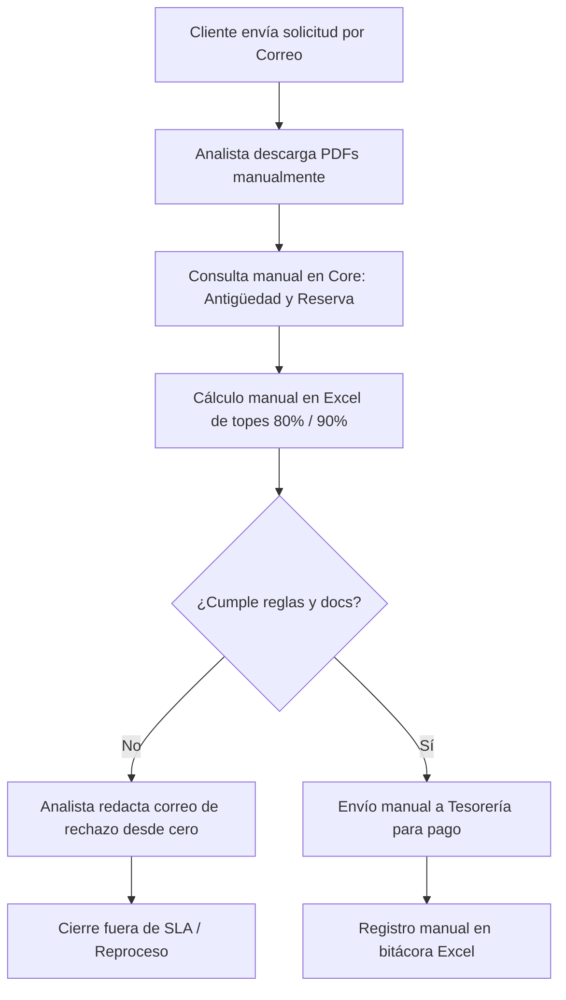
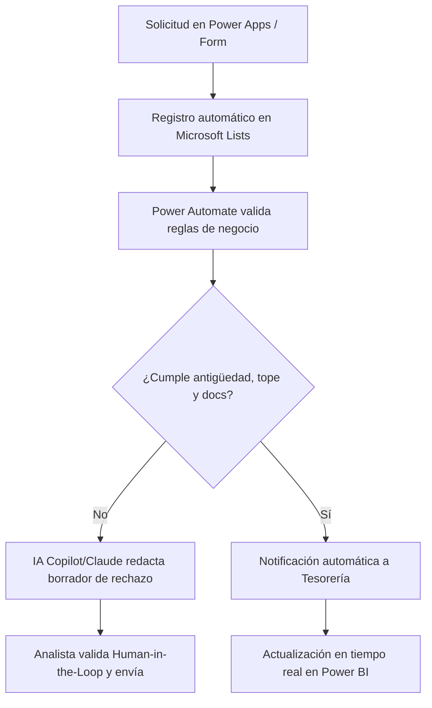

# automatizacion-operaciones-ssi-seguros
Proyecto integral de automatización y análisis operativo (BAU) para seguros de vida (SSI). Incluye rediseño de flujos AS-IS / TO-BE con Power Platform, arquitectura de prompts con IA (Copilot/Claude) bajo enfoque Human-in-the-Loop, simulación de reglas de negocio en Python y tablero ejecutivo de SLA en Power BI.
# 🚀 Optimización y Automatización del Flujo de Rescates y Préstamos (SSI - Seguros de Vida)

Proyecto integral de transformación operativa y análisis de datos (BAU) diseñado para optimizar la gestión de solicitudes de **rescates, préstamos sobre pólizas y mantenimiento de cuentas SSI**.

## 🎯 Objetivo del Proyecto
Eliminar cuellos de botella derivados de la recepción manual por correo electrónico, asegurar el cumplimiento de los **Acuerdos de Nivel de Servicio (SLA)** y estandarizar la validación de reglas de negocio mediante **Microsoft Power Platform**, **Inteligencia Artificial (Human-in-the-Loop)** y **Power BI**.

---

## 🔄 Mapeo de Procesos: AS-IS vs. TO-BE

### Proceso Actual (AS-IS - Gestión Manual)

### Proceso Propuesto (TO-BE - Automatizado con Power Platform e IA)

---

## 🛠️ Arquitectura de la Solución
1. **Simulación y Reglas de Negocio (`scripts/` & `data/`):** Base de 800 solicitudes generada en **Python** aplicando reglas reales de suscripción (antigüedad mínima de 12/24 meses y topes del 80%/90% sobre reserva matemática).
2. **Automatización e IA (`ai_prompts/`):** Diseño de flujos en **Power Apps, Microsoft Lists y Power Automate** con alertas preventivas en Teams al 70% del SLA, complementado con librería de *prompts* para **Microsoft Copilot / Claude** enfocados en auditoría rápida y comunicación empática de rechazos.
3. **Analítica Ejecutiva (`power_bi/`):** Tablero interactivo con medidas **DAX** para monitorear cumplimiento de SLA, causas raíz de rechazo y montos operados.

